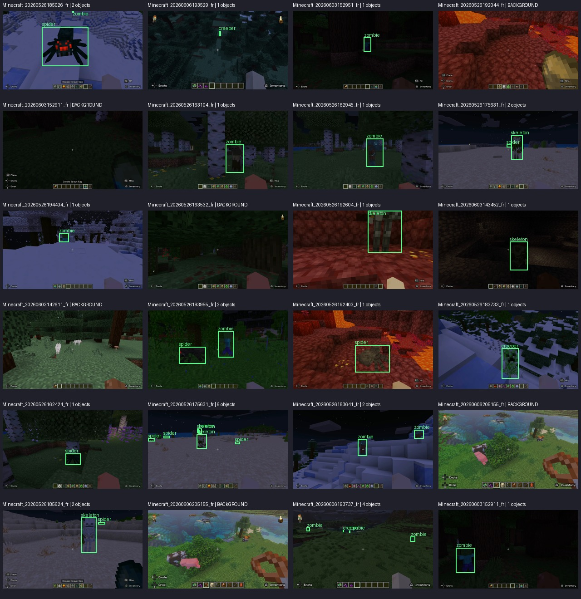

# SceneForgeCV
### Computer Vision · Image Classification · Object Detection

SceneForgeCV is a computer vision project focused on recognizing and detecting Minecraft mobs in game screenshots. It combines a deep learning image classifier with an object detection model to explore two complementary computer vision tasks.

The project covers dataset inspection, annotation validation, image preprocessing, model training, evaluation, inference, and performance reporting using Python and PyTorch-based tooling.



## Project Overview

SceneForgeCV implements two computer vision pipelines:

| Pipeline | Model | Objective |
|---|---|---|
| Image classification | ResNet18 | Classify a cropped mob image into one of five categories |
| Object detection | YOLOv8n | Locate mobs in a screenshot and predict their classes with bounding boxes |

The project currently focuses on **visual recognition and object detection**, rather than segmentation or multi-object tracking.

## Supported Classes

The models work with five Minecraft mob categories:

- Creeper
- Skeleton
- Spider
- Zombie
- Enderman

## Dataset

The project uses the [Minecraft Mobs YOLO Dataset](https://huggingface.co/datasets/hmnshudhmn24/minecraft-mobs-yolo-dataset).

| Split | Images |
|---|---:|
| Training | 2,068 |
| Validation | 517 |
| **Total** | **2,585** |

The dataset contains YOLO-format bounding-box annotations. Dataset inspection identified 3,336 valid annotated object instances, alongside images with no labeled objects.

For classification, annotated bounding boxes are converted into cropped images, with the original image-level train/validation split preserved.

## Methodology

### 1. Dataset validation

- Inspect image and annotation files.
- Validate bounding-box coordinates and class IDs.
- Review class distribution and background-only images.
- Generate a contact sheet for visual inspection.
- Identify invalid or unusually small annotations.

### 2. Image classification

A pretrained ResNet18 model is fine-tuned on cropped mob images. The classifier learns to distinguish the five categories from individual image crops.

The training pipeline tracks loss and accuracy and saves the best checkpoint based on validation accuracy.

### 3. Object detection

YOLOv8n is trained using the original images and bounding-box annotations. The detector predicts object locations, class labels, and confidence scores.

Evaluation uses precision, recall, mAP@50, and mAP@50–95.

### 4. Evaluation and reporting

The project includes scripts for evaluating both models, generating metric visualizations, running predictions, and producing a consolidated project summary.

Project visualizations are intended to be saved as PNG files, with structured evaluation results saved as JSON.

## Preliminary Results

The following results were recorded during the initial training runs. They should be treated as preliminary until the final evaluation scripts have been tested and their reports verified.

| Metric | Preliminary result |
|---|---:|
| ResNet18 validation accuracy | 98.92% |
| YOLOv8n precision | 95.1% |
| YOLOv8n recall | 85.7% |
| YOLOv8n mAP@50 | 91.7% |
| YOLOv8n mAP@50–95 | 73.5% |

Classification accuracy measures performance on the cropped validation images, while detection metrics measure object localization and classification on full validation images. These metrics are not directly comparable.

Results on this dataset do not necessarily predict performance on different games, visual styles, or real-world images.

## Technology Stack

- Python
- PyTorch and Torchvision
- Ultralytics YOLOv8
- Pillow and NumPy
- PyYAML
- Plotly for project visualizations
- pytest for automated testing

## Project Structure

```text
SceneForgeCV/
├── configs/
│   └── config.yaml
├── data-source/                 # Local dataset; excluded from Git
├── data/
│   └── processed/               # Generated classification crops
├── checkpoints/                 # Local classifier weights
├── runs/                        # Detection training and predictions
├── reports/
│   ├── figures/
│   │   └── train_contact_sheet.jpg
│   ├── classification/
│   └── detection/
├── src/
│   ├── prepare_classification_crops.py
│   ├── train_classifier.py
│   ├── train_detector.py
│   ├── evaluate_classifier.py
│   ├── evaluate_detector.py
│   ├── visualize_classifier.py
│   ├── visualize_results.py
│   ├── predict.py
│   ├── inference.py
│   └── generate_report.py
├── tests/
├── .gitignore
└── README.md
```

Generated files and directories may evolve as testing and reporting are finalized.

## Setup

Create and activate a virtual environment:

```powershell
python -m venv .venv
.\.venv\Scripts\Activate.ps1
```

Install the project dependencies according to the repository's dependency configuration.

A CUDA-compatible PyTorch installation and a supported NVIDIA GPU are recommended for GPU-accelerated training. CPU execution may be possible but can be significantly slower.

## Running the Project

The main scripts are:

```powershell
python .\src\prepare_classification_crops.py
python .\src\train_classifier.py
python .\src\train_detector.py
python .\src\evaluate_classifier.py
python .\src\evaluate_detector.py
python .\src\visualize_classifier.py
python .\src\visualize_results.py
python .\src\generate_report.py
```

Run training only when necessary; trained checkpoints are generated locally and are not intended to be committed to the repository.

## Limitations

- The dataset is limited to five Minecraft mob categories.
- Classification evaluates cropped objects rather than arbitrary full screenshots.
- Small, occluded, or visually ambiguous objects can be difficult to detect.
- The dataset's validation results do not establish generalization to unrelated domains.
- Final automated testing and report verification remain part of the project completion process.

## Future Improvements

- Add automated tests for preprocessing, inference, and evaluation.
- Analyze class-specific errors and difficult detection cases.
- Improve reproducibility and document dependency versions.
- Expand the evaluation dataset and test generalization.
- Refine the final report and add selected PNG prediction examples.

## Author

**Sami Mahdadi**

- GitHub: [@sxmimhd](https://github.com/sxmimhd)

---

*SceneForgeCV is a computer vision portfolio project demonstrating dataset preparation, deep learning model training, object detection, image classification, and model evaluation.*